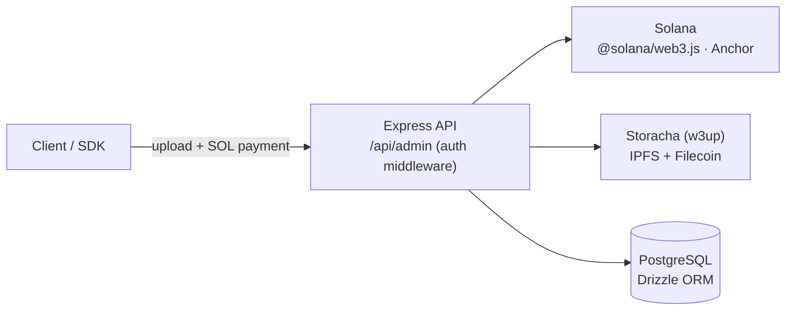

# Solana-Storacha

### Test and dev server for Storacha storage paid with Solana

     

A development backend used while building the [Storacha Solana SDK](https://github.com/seetadev/IPFS-Solana-SDK). It's an Express service that accepts SOL payments and pins files to IPFS/Filecoin through Storacha. Deposit records are kept in Postgres via Drizzle, and admin routes are protected.



```bash
cd storacha-solana-pay
npm install && cp .env.example .env
npx drizzle-kit migrate
npx ts-node src/index.ts
```
